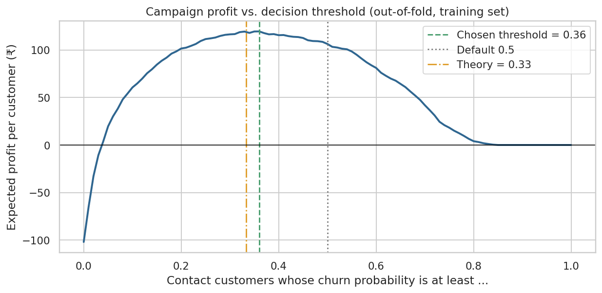

# Telecom Customer Churn: From Model to Decision

Which customers should a telecom company contact to keep them, and does the campaign actually pay off?

This project goes beyond "fit a model, report F1". It selects models with proper cross-validation, calibrates the probabilities, turns them into a **profit-optimal retention decision**, explains the predictions, documents where the model fails, and ships a reusable, tested Python package.

**Data:** IBM Telco Customer Churn sample dataset (7,043 customers, 21 columns, 26.5% churn).

## Headline results (locked test set, 1,409 customers)

| Metric | Result |
|---|---|
| Selected model | Tuned and calibrated **logistic regression** (simplest model within 1 standard error of the best CV score) |
| ROC-AUC | **0.841** (95% bootstrap CI 0.817 to 0.861) |
| PR-AUC | **0.627** (no-skill baseline 0.265) |
| At the profit-optimal threshold (0.36) | recall **71%**, precision **55%** |
| Campaign value (assumed economics) | about **+₹110 per customer**, vs about −₹102 for contacting everybody |



## What makes this more than a tutorial

1. **No test-set leakage.** The test set is locked. Every choice (model, hyper-parameters, calibration, threshold) is made with cross-validation or out-of-fold predictions on the training set only.
2. **Honest negative results.** Engineered features did not help, and all model families plateau at an AUC of about 0.85. The data, not the algorithm, is the limit.
3. **One-standard-error rule.** LightGBM scored marginally higher in CV, but within noise, so the simpler and more explainable model is shipped.
4. **Calibration.** `class_weight="balanced"` inflates probabilities (mean predicted 0.41 vs true 0.27). Platt scaling fixes this so expected-value calculations are valid.
5. **A decision, not just a metric.** The threshold comes from campaign economics. Sensitivity analysis shows the **save rate** is the assumption that matters most, so the first real-world step is an A/B test to measure it.
6. **Explainability.** Logistic-regression coefficients describe the shipped model. SHAP (global and per-customer) is computed on the tuned LightGBM challenger as a cross-check, and both views tell the same story: contract type and tenure dominate.
7. **Error analysis by segment.** The model is strong on new and month-to-month customers, and blind to sudden departures of loyal, long-contract customers (this would need behavioural data).
8. **Segmentation.** K-Means finds one segment (new month-to-month customers) holding about 83% of all churners.

## Project layout

```
data/                 WA_Fn-UseC_-Telco-Customer-Churn.csv (IBM sample data)
notebooks/            churn_analysis_final.ipynb   <- the narrative: EDA -> models -> decision -> errors
src/
  data.py             loading, cleaning (hidden-null fix), stateless feature engineering
  features.py         preprocessing (fit inside the pipeline: no leakage)
  models.py           candidate models, search spaces, 1-SE selection rule
  profit.py           retention economics, profit curve, optimal threshold
  train.py            CLI: reproduces the notebook's final model
  predict.py          load the saved model and score new customers
api.py                FastAPI service: POST /predict scores one customer
tests/                pytest suite (cleaning, leakage, probabilities, profit maths, selection rule)
models/               churn_model.joblib (model + threshold + metadata)
reports/              metrics.json, figures/
```

## Run it

```bash
pip install -r requirements.txt
jupyter lab notebooks/churn_analysis_final.ipynb      # or: jupyter nbconvert --execute --to notebook ...
python -m src.train                                    # retrain + save model (about 1 min on a laptop)
python -m src.train --contact-cost 300 --success-rate 0.2   # re-run with your own campaign economics
pytest                                                 # 17 tests
```

Score new customers:

```python
from src.data import clean, load_raw, split_xy
from src.predict import score

X, _ = split_xy(clean(load_raw()).head(10))
print(score(X))          # churn_probability, contact (bool), risk_tier
```

## Serve it as an API

```bash
uvicorn api:app --reload
```

Open `http://127.0.0.1:8000/docs` for interactive documentation. `POST /predict` takes one customer and returns the churn probability, the contact decision and a risk tier. Invalid input is rejected with a 422 error.

## Limitations

- Snapshot data with no time dimension. A real deployment needs out-of-time validation and drift monitoring.
- Campaign economics (₹500 contact cost, ₹5,000 customer value, 30% save rate) are **assumptions**, not facts from the data.
- Results show associations, not causal effects. Use an A/B test before acting on any "driver".
- `gender` and `SeniorCitizen` are used as features. Audit or remove protected and proxy attributes in production.
- Hyper-parameter search scores are slightly optimistic because the best CV score is selected. The final locked-test numbers are the unbiased estimate.

## Next step

 Containerize the API with Docker and add request logging.

## Data source

IBM Telco Customer Churn sample dataset, a widely used public teaching dataset. Check the original source for its license terms before reuse.
